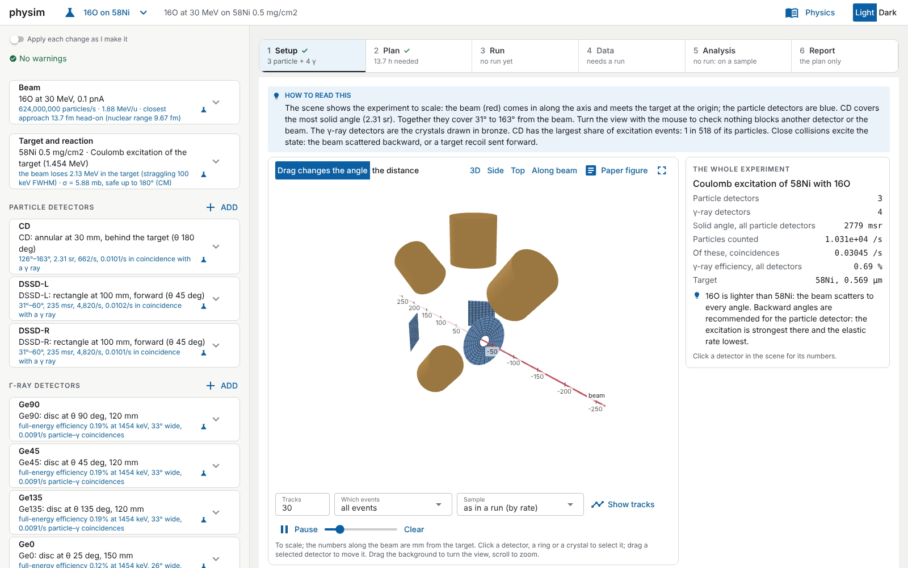
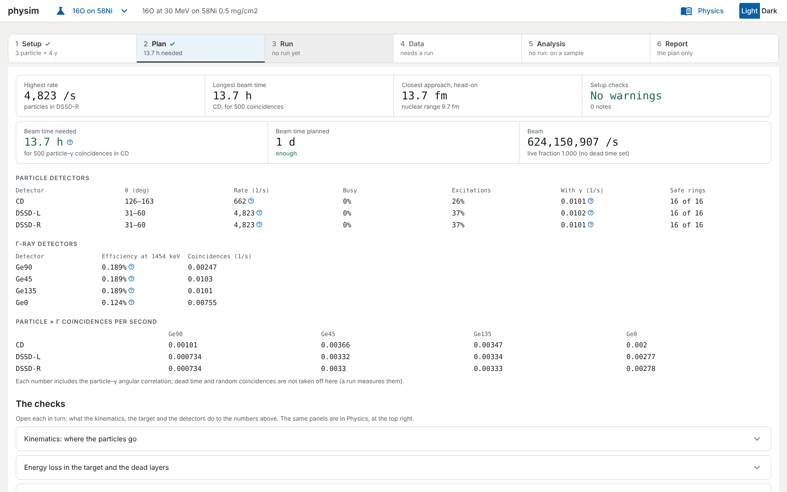
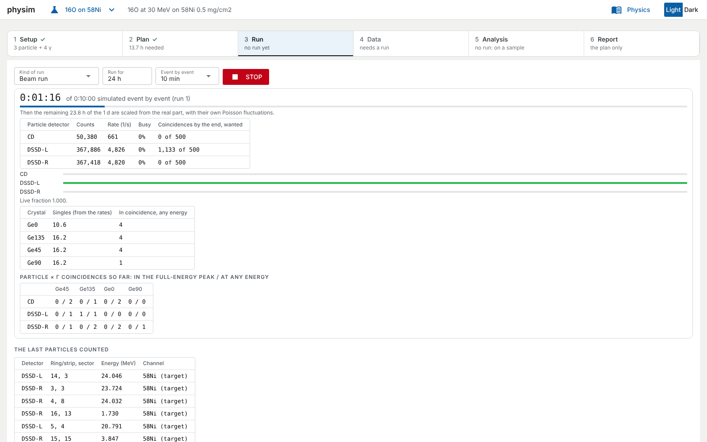
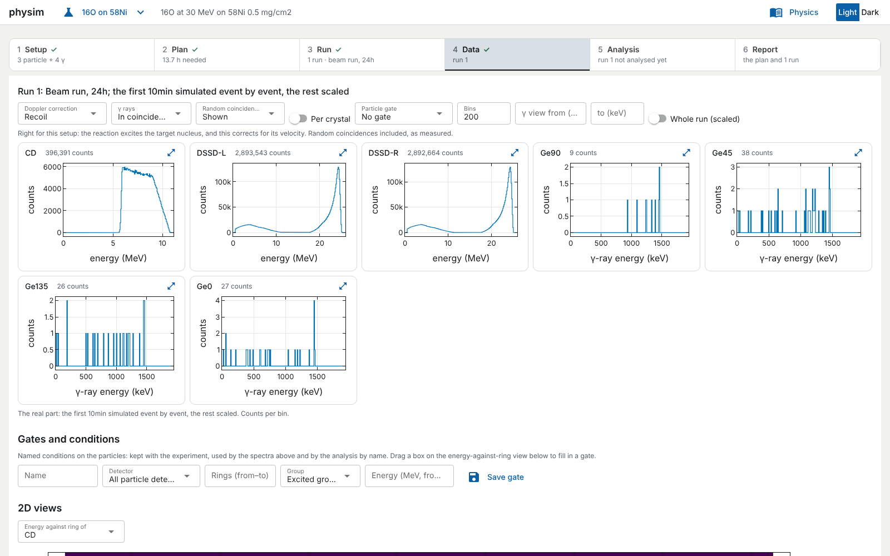
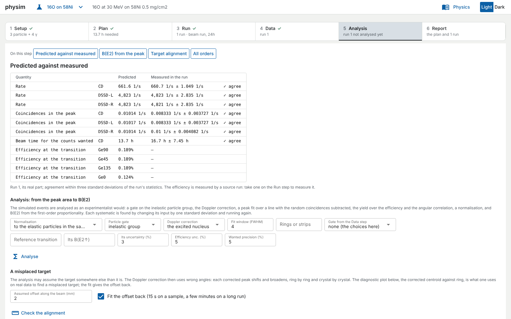

# physim

[](https://github.com/Ren-shi/notebook_automation/actions/workflows/ci.yml)

physim is two things built on one Rust core:

- **The experiment planner**: a point-and-click app for planning nuclear-physics beam time (Rutherford
  scattering and Coulomb excitation). Describe the beam, the target and the detectors; it shows the
  experiment to scale, works out the rates and the beam time you need, simulates the runs, lets you gate and
  analyse the spectra, and writes the report. No code needed, and it runs on your own computer.
- **The physics engine**: a classical-mechanics engine for point particles, with grid solvers for fields and
  single-particle quantum mechanics. The time stepping and forces run in **Rust**; **Python** (via
  [PyO3](https://pyo3.rs) and [maturin](https://www.maturin.rs)) sets up systems and analyses results.



## The experiment planner

### Start it

**Windows, without Python:** download `physim-planner-…-windows-x64-setup.exe` from the
[releases page](https://github.com/Ren-shi/notebook_automation/releases) and run it. It needs no administrator
rights and adds **physim planner** to the Start menu; the planner opens in its own window.

**Anywhere with Python 3.11+:**

```bash
pip install "physim-engine[app,root]"
physim app                                   # opens http://localhost:8080 in your browser
physim app --example coulex_ni58             # start from an example
physim app --window                          # its own window (add the [window] extra)
```

It listens only on this computer by default (`--host 0.0.0.0` serves the local network). There are no accounts
and nothing is uploaded. The full guide is [`docs/planner-app.md`](docs/planner-app.md).

### Six steps, from setup to report

The step bar runs **1 Setup → 2 Plan → 3 Run → 4 Data → 5 Analysis → 6 Report**. Each step shows its status,
ticks when it has its result, and ends with a button to the next one.

| Step | What you do and see |
|---|---|
| **Setup** | The chamber in 3D, to scale: beam, target, particle detectors (rings, strips) and γ-ray detectors (crystals). Turn, zoom, click a detector for its numbers and drag it to move it. Change the beam, target, reaction, level schemes and detectors in the panel on the left, then Apply. Draw sample particle tracks. |
| **Plan** | The answers first: the beam time your counts need against the time planned, each detector's rate, busy fraction and safe rings, γ-ray efficiencies, and the particle × γ coincidence rates. Below them, the checks: kinematics, energy loss, the Rutherford orbit and safe distance, angular correlation and Doppler shifts, efficiency curves, and predicted spectra. |
| **Run** | Simulate a beam run, a calibration source run or a target-alignment check. Counts, rates and the coincidence matrix fill in live; Stop or Extend at any time, and watch events as tracks in the scene. |
| **Data** | Every spectrum of the run at once. Doppler correction, particle gates, singles or coincidences, random subtraction, add-back and Compton suppression, binning. Named gates, 2D views (energy against ring, γ-ray energy against crystal), comparing runs, and export to ROOT or `.npz`. |
| **Analysis** | Predicted against measured, row by row, with agreement within the run's statistics. B(E2) from the γ-ray peak, with its statistical and systematic uncertainties. Finding a misplaced target, a multi-step (all orders) fit of the matrix element, and a GOSIA input file. |
| **Report** | One document: the setup and level schemes, the plan, every run's spectra and gates, the analysis, every number explained, and the method. Save as PDF or HTML, or save everything (setup, tables, figures, data) as a zip. |

**Physics**, at the top right, is the reference behind every number: nuclear data, kinematics, energy loss, the
Rutherford orbit, detector response, rates and events, and Coulomb excitation, each linked to its tests. The **?**
beside a number shows how it was worked out. Light and dark themes are built in, and figures can be exported in
journal styles for a paper.

<table>
<tr>
<td></td>
<td></td>
</tr>
<tr>
<td align="center"><b>Plan:</b> rates and beam time before asking for beam</td>
<td align="center"><b>Run:</b> a simulated run filling in live</td>
</tr>
<tr>
<td></td>
<td></td>
</tr>
<tr>
<td align="center"><b>Data:</b> every spectrum, gated and Doppler-corrected</td>
<td align="center"><b>Analysis:</b> predicted against measured, and B(E2)</td>
</tr>
</table>

### Setups, examples and scripting

An experiment is a plain-text TOML setup file that the app, scripts and notebooks all read and write, so you can
save it, share it and attach it to a proposal (format: [`docs/nuclear-setup.md`](docs/nuclear-setup.md)). Four
examples come with it:

| Example | What it is |
|---|---|
| `alpha_on_gold` | 5.5 MeV alpha particles on gold foil, with silicon detectors at six angles (Rutherford's distribution) |
| `oxygen_on_lead_array` | 16O on 208Pb below the barrier, with strip detectors forward and backward |
| `coulex_ni58` | Safe Coulomb excitation of 58Ni's first 2+ state with a 30 MeV 16O beam and four germanium detectors |
| `coulex_ni62_pt194` | A 62Ni beam on 194Pt seen at backward angles, with ENSDF level schemes and multi-step excitation |

Without the app:

```bash
physim report coulex_ni58 -o report --pdf    # write the beam-time report (HTML, CSV, figures) for a setup
```

From Python, `physim.nuclear` gives the same pieces: kinematics, stopping powers, Rutherford and Coulomb
excitation cross sections, detector geometry and γ-ray response, rates, event generation, analysis and reports.

What it does not do yet: transfer and fusion-evaporation reactions (elastic scattering and Coulomb excitation are
supported), and it is meant for one person on their own computer, not for hosting for a group.

## The physics engine

```python
import physim as ps

w = ps.World(integrator="yoshida4")
w.add_particle([0.5, 0, 0], vel=[0, 0.4, 0], mass=0.5)
w.add_particle([-0.5, 0, 0], vel=[0, -0.4, 0], mass=0.5)
w.add_force(ps.NewtonianGravity(G=1.0))

traj = w.run(dt=1e-3, steps=10_000, record_every=10)
traj.pos.shape                      # (frames, particles, 3)
ps.relative_energy_error(traj)      # (E - E0) / |E0| per frame
```

What it covers (the full tour, with the API for each, is the [user guide](docs/guide.md)):

- **Integrators:** Euler, Verlet, Yoshida 4/6/8, PEFRL, Blanes–Moan, RK4, Dormand–Prince, Gauss–Legendre
  (implicit, symplectic), Wisdom–Holman for planetary systems, and the Boris pusher. You can also compose your own.
- **Adaptive time stepping** with error control and dense output.
- **Forces:** gravity (direct sum, Barnes–Hut tree, particle-mesh), springs, drag, electric and magnetic fields,
  pair potentials for molecular dynamics (Lennard-Jones and others), thermostats, and your own forces in Python.
- **Constraints, collisions and events:** rigid rods (RATTLE), hard collisions and walls, and the exact moment an
  event happens.
- **Rigid bodies** with quaternions and torques.
- **Chaos indicators:** Lyapunov exponents and MEGNO.
- **Fields on grids:** waves, diffusion and Poisson's equation in 1D, 2D and 3D.
- **Quantum mechanics:** the Schrödinger equation for wave packets, tunnelling and bound states.
- **Scenarios and units** for standard systems, checkpoints, saving and streaming, deterministic multi-core
  forces, and plotting.

The [`notebooks/`](notebooks/) are worked examples: integrator comparisons and measured convergence orders, an
N-body star cluster, three-body chaos, a driven oscillator's route to chaos, charged particles in a magnetic bottle,
fields on grids, particle accelerators (an electrostatic column, a drift-tube linac, cyclotrons, Rutherford
scattering), and quantum mechanics. Standalone Rust programs are in [`examples/`](examples/)
(`cargo run --release --example outer_solar_system`).

Install the library:

```bash
pip install physim-engine                 # the import name is physim
pip install "physim-engine[plot]"         # with matplotlib for physim.plot ([plot3d] adds plotly, [io] h5py)
```

Prebuilt wheels cover Linux x86_64/aarch64, macOS x86_64/arm64 and Windows x64 (one abi3 wheel per platform for
Python ≥ 3.9) and need no Rust toolchain. The distribution is called `physim-engine` because `physim` is taken on
PyPI.

## Documentation

The documentation site builds from [`docs/`](docs/) and is published to GitHub Pages on each release:

- [The planner app](docs/planner-app.md) and [setup files](docs/nuclear-setup.md)
- [Quickstart](docs/quickstart.md) and the [engine user guide](docs/guide.md)
- Theory notes ([`docs/theory/`](docs/theory/)) on every integrator, force and piece of nuclear physics
- The [physics register](docs/physics-register/README.md) and [validation](docs/validation.md): every number
  the planner shows, with the tests and comparisons behind it
- Python and Rust API references ([`docs/api/`](docs/api/))

```bash
pip install -r docs/requirements.txt && sphinx-build -W -b html docs docs/_build/html
```

## Development

Requires a Rust toolchain and Python ≥ 3.9.

```bash
python -m venv .venv && source .venv/bin/activate
pip install -r requirements-dev.txt jupyter
maturin develop --release        # builds the Rust extension into the venv; rerun after Rust changes
```

Tests and benchmarks:

```bash
cargo test --release                 # Rust physics tests (convergence orders, conservation laws)
pytest tests/python                  # Python tests, including the nuclear library and the planner app
python scripts/run_notebooks.py      # execute the example notebooks, fail on any error
cargo bench --bench engine           # Rust engine (criterion); reports in target/criterion/
python benches/python_overhead.py    # Python call overhead and CustomForce cost
```

CI ([`.github/workflows/ci.yml`](.github/workflows/ci.yml)) runs the tests plus `cargo fmt --check` and
`cargo clippy --all-targets --features python -- -D warnings` on every push and pull request. Baseline benchmark
numbers are in [`backlog/02-benchmarks.md`](backlog/02-benchmarks.md).

**Adding a force or an integrator:** prototype it in Python with `ps.CustomForce`, then port it to Rust (implement
the `Force` trait under `src/forces/`, or `Integrator` under `src/integrators/`) and expose it in `src/python.rs`.
The step-by-step guide, with validation checks, is [`docs/new-ideas.md`](docs/new-ideas.md).

**Releases:** bump `version` in `Cargo.toml` (shared by the crate, the wheel and `physim.__version__`), note the
changes in [`CHANGELOG.md`](CHANGELOG.md), merge, and push a tag `vX.Y.Z`. The
[release workflow](.github/workflows/release.yml) builds and tests the wheels and the sdist and publishes to PyPI by
trusted publishing (configure the PyPI project's trusted publisher for this repository and workflow, environment
`pypi`). The [installer workflow](.github/workflows/installer.yml) builds the Windows planner installer and
attaches it to the release. Publishing the Rust crate is opt-in (repository variable `PUBLISH_CRATE=true` and
secret `CARGO_REGISTRY_TOKEN`).

Planned work lives in [`backlog/`](backlog/README.md), one file per item with priority, scope and acceptance
criteria.

## Layout

```
src/
  vec3.rs, state.rs   3-vector math; positions, velocities, masses, time; conserved quantities
  world.rs            World (state + forces + integrator), run loop, Recorder, Trajectory
  forces/             Force trait, ForceSet, built-in forces (central, springs, em, pair, tree, contact, ...)
  integrators/        Integrator trait and schemes (splitting, gauss, wisdom_holman, boris, thermostat)
  adaptive.rs         adaptive Dormand-Prince run loop (error control, dense output)
  chaos.rs            variational equations, Lyapunov exponents, MEGNO
  collisions.rs       event-driven hard collisions and walls (broadphase.rs: uniform grid)
  events.rs           event functions and crossing detection
  constraints.rs      rigid rods and the RATTLE projections
  rigid.rs            rigid bodies: quaternions, torques, splitting step (RigidSystem)
  fields/             grids, wave/heat/Poisson solvers, FFT, particle-mesh gravity, Schrödinger equation
  nuclear/            reaction kinematics, stopping powers, detectors, event generation
  checkpoint.rs       save/restore a World
  parallel.rs         deterministic block-parallel helpers
  python.rs, python/  PyO3 bindings (feature "python")
python/physim/        Python package: the engine's front end, analysis, scenarios, units, plotting, type stubs
  nuclear/            the nuclear library: setups, level schemes, rates, events, analysis, reports
  nuclear/app/        the planner app (NiceGUI): one module per step
  nuclear/examples/   example setup files
installer/windows/    the one-click Windows installer of the planner
scripts/              developer tools (notebook runner, nuclear data fetchers)
tests/                Rust tests; tests/python for the bindings, the nuclear library and the app
benches/              Rust (criterion) and Python benchmarks
examples/             standalone Rust programs (cargo run --release --example <name>)
notebooks/            example notebooks (also rendered in the docs)
docs/                 documentation site (Sphinx): planner guide, user guide, theory, physics register, API
backlog/              planned work
```

Licensed under the MIT license ([`LICENSE`](LICENSE)).
